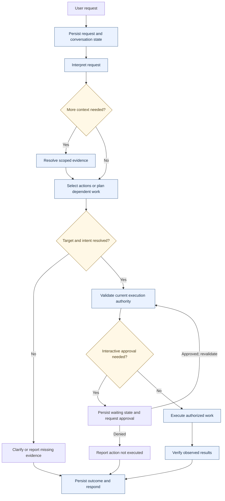
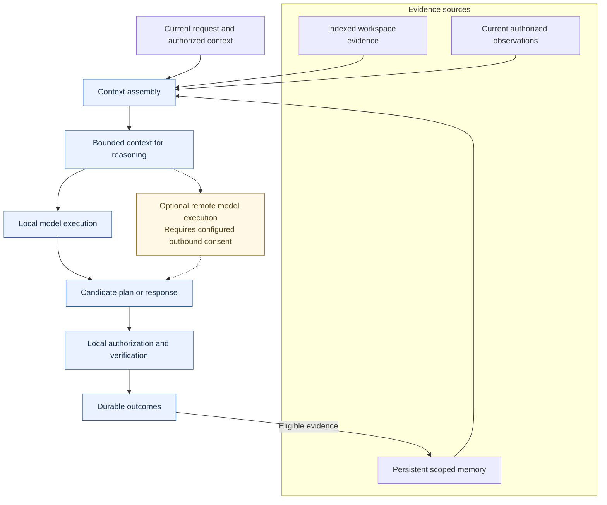

# Architecture

[Overview](README.md) · [Case studies](ENGINEERING.md) · [Capabilities](CAPABILITIES.md)

## Responsibility boundaries

IntentOS coordinates requests through durable state, interpretation, context assembly, planning, authorized actions, and observed results. Vexon is a voice-facing client of that coordination system. It does not establish a separate authority to execute privileged actions.

| Subsystem | Responsibility | Architectural tradeoff |
| --- | --- | --- |
| Request coordination | Conversation continuity, task lifecycle, supervised work and restart state | Durable bookkeeping adds latency but makes incomplete work inspectable |
| Semantic interpretation | Resolve meaning and candidate capabilities; request clarification when evidence is insufficient | Cheap local interpretation covers a bounded surface; harder requests need model reasoning |
| Context assembly | Combine scoped history, retrieval, and current observations within a finite budget | More evidence can improve grounding while increasing latency and model-context pressure |
| Planning | Decompose supported requests and coordinate dependent work | Parallel work must respect dependencies and shared application state |
| Authorized execution | Validate current authority, obtain approvals where needed, coordinate adapters | Capability discovery and language similarity cannot confer permission |
| Workstation integration | Observe and operate terminals, windows, browsers, files, and project resources | Native interfaces improve evidence quality but introduce host-specific behavior |
| Inference services | Supply local model reasoning and optional remote workloads | Remote capacity changes privacy, availability, and cancellation assumptions |
| Persistent memory | Retain eligible evidence, corrections, and scoped historical context | Useful continuity requires freshness and provenance, not unlimited retention |

The CPU semantic capability matcher and model-assisted interpretation are implemented paths. The separately trained compact parser remains experimental and is not represented as the runtime's reliable semantic engine.

## Request lifecycle

*Context retrieval and interactive approval are conditional. A directly resolved request can avoid generative reasoning; a complex request can require several planning/execution rounds. Every effect remains subject to current authority checks.*

The lifecycle is not a universal linear pipeline. Interpretation can expose missing context; clarification ends a turn without executing an unresolved target. Approval waiting is persistent. After an interruption, current state must be inspected before deciding whether continuation is supported. A read-only conversational answer can omit workstation effects entirely.

## Memory and inference

*Memory supplies evidence for reasoning. Verified outcomes can become eligible historical evidence. Execution authority remains local regardless of where reasoning runs.*

Workspace retrieval includes lexical and semantic search with optional reranking. Historical memory also supports structured project/time queries. These answer different questions: similarity can surface relevant material, while temporal evidence determines whether an event belongs in a requested period. Neither source alone proves the state of a currently running application.

Local and remote providers share an inference-facing abstraction. The inference gateway serves model workloads rather than workstation effects; backend model servers retain responsibility for GPU scheduling. Streaming and connection cleanup are implemented, but the selected evidence does not establish sustained remote operation under cancellation and saturation.

## Concurrency, persistence, and state

Durable request scheduling and dependency-aware action coordination operate at different levels. Compatible actions can overlap in tested paths; resource conflicts and dependencies require ordering. Multiple service workers do not establish unrestricted parallel model inference or a measured throughput guarantee.

Saved workstation definitions express intended setup. Live resource observations express current reality. Memory expresses historical evidence. Treating these as separate authorities prevents a recalled setup from silently replacing the current definition or a saved edit from being reported as a live process change.

Local SQLite paths are exercised by the selected measurements. PostgreSQL support exists for parts of orchestration/checkpointing; the structured activity engine is SQLite-specific. This is not evidence of interchangeable database deployments.
