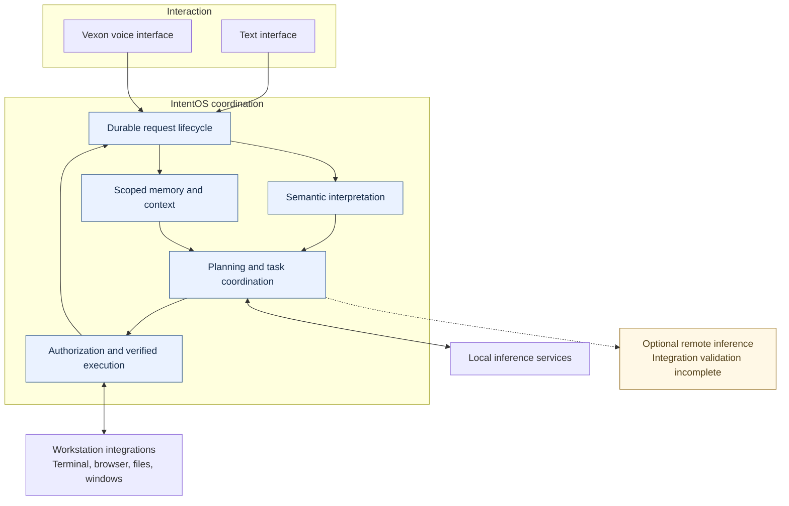

# IntentOS

**A private AI coordination system for context-aware, authorized execution across a stateful Linux workstation.**

IntentOS turns natural-language requests into bounded tasks that combine reasoning, retrieval, persistent state, and workstation tools. The engineering objective is to preserve intent, ownership, and verifiable outcomes across applications, approvals, interruptions, and restarts. Model output is a proposal; successful execution requires evidence from the system that performed the work.

**Verified technology footprint:** Python, Pydantic, LangGraph, SQLite, Ollama, ONNX Runtime, FastAPI, and Linux desktop integrations. Vexon adds an asynchronous voice interface. Optional remote inference is implemented; its current operational validation is incomplete.

*Conceptual architecture. Dashed connections indicate an optional inference path with incomplete integration validation. The experimental trained semantic parser is excluded from the active architecture.*

[Architecture](ARCHITECTURE.md) · [Engineering case studies](ENGINEERING.md) · [Measurements](PERFORMANCE.md) · [Reliability](RELIABILITY.md) · [Capabilities](CAPABILITIES.md) · [Limitations](LIMITATIONS.md)

## Engineering highlights

- **Durable task coordination.** Requests, approvals, execution outcomes, and conversation state survive process boundaries. Dependency-aware execution coordinates compatible work while preserving ordering for shared resources. Restart and cancellation tests exercise real disposable resources.
- **Stateful workstation execution.** Saved workstation definitions are versioned separately from live application state. Reconciliation checks resource identity and ownership, addressing duplicate sessions, stale bindings, partial failures, and the difference between changing a saved setup and stopping a live process.
- **Memory for contextual execution.** Scoped retrieval combines historical evidence, current observations, and indexed workspace material. Temporal queries distinguish when an event occurred from when it was stored; corrections invalidate derived context. Retrieved history carries no execution authority.
- **Inference under resource constraints.** Local inference and CPU semantic matching serve different responsibilities. Bounded context and optional remote providers address capacity and privacy tradeoffs. Offline prompt-fitting evaluation verifies a previously failing workload without claiming an end-to-end model speedup.
- **Evidence-based completion.** Authorization, action dispatch, observed state, and useful task completion are separate concerns. Browser and editor acceptance probes verify concrete state rather than treating generated prose as proof.

## Measured engineering outcomes

These are historical development measurements, not production service guarantees. Evidence IDs link to methods, dates, environments, and limitations.

| Evidence | Observed result | What it demonstrates |
| --- | --- | --- |
| [E1: regression suite](PERFORMANCE.md#e1--regression-suite) | 2,232 passed; 55 skipped; 12 warnings | Breadth of one recorded acceptance run; later source changes prevent treating it as current certification |
| [E2: idle recovery scan](PERFORMANCE.md#e2--idle-recovery-scan) | p50 57.53–60.39 ms → 1.09–1.23 ms | Reduced scheduler bookkeeping in a matched local benchmark; no tools or model calls |
| [E3: context fitting](PERFORMANCE.md#e3--context-fitting) | 0/20 → 20/20 successful fits | Repeated offline replay of one discovery-heavy context workload; no inference |
| [E4: historical retrieval](PERFORMANCE.md#e4--historical-retrieval) | Exact source sets 0/4 → 4/4 | Correct project/time evidence on a small controlled ledger; no general QA accuracy claim |

## Engineering case studies

[Reducing coordination overhead](ENGINEERING.md#1-reducing-coordination-overhead) traces measurement boundaries and context budgets. [Reliable workstation execution](ENGINEERING.md#2-reliable-workstation-execution) examines saved versus live state. [Persistent contextual memory](ENGINEERING.md#3-persistent-contextual-memory) covers evidence freshness and ambiguity. [Inference placement](ENGINEERING.md#4-local-and-remote-inference) explains provider separation. [Securing execution](ENGINEERING.md#5-securing-tool-enabled-execution) describes authority and recovery principles.

## Project status

| Status | Scope |
| --- | --- |
| Implemented and verified in bounded tests | Durable local execution, scoped memory, saved workstations, selected native desktop operations |
| Implemented; validation incomplete | Vexon physical audio pipeline, optional remote inference, broad contextual multi-action execution, PostgreSQL orchestration path |
| Experimental | Separately trained compact semantic parser; held-out generalization is insufficient for a production claim |
| Planned validation work | Sustained-load evaluation, representative speech-to-effects corpus, broader task and retrieval quality evaluation |

“Verified” means the specific evidence described here exists. It does not mean every language form, deployment, or failure mode has been tested. This is an actively developed system; the inspected source differs from the historical acceptance snapshot. See [capability boundaries](CAPABILITIES.md).

## Repository scope and attribution

This repository is a technical documentation and engineering showcase for IntentOS. It contains architecture overviews, design decisions, and verified engineering results. The implementation source code, model artifacts, internal configurations, and operational details are maintained privately.

The integration and systems design are presented as project work; third-party frameworks and pretrained models remain their creators’ work. Private repository metadata does not establish sole authorship of every component. This page makes no sole-author claim. See [attribution](ATTRIBUTION.md) and the [rights notice](LICENSE). No organization endorsement is implied.
