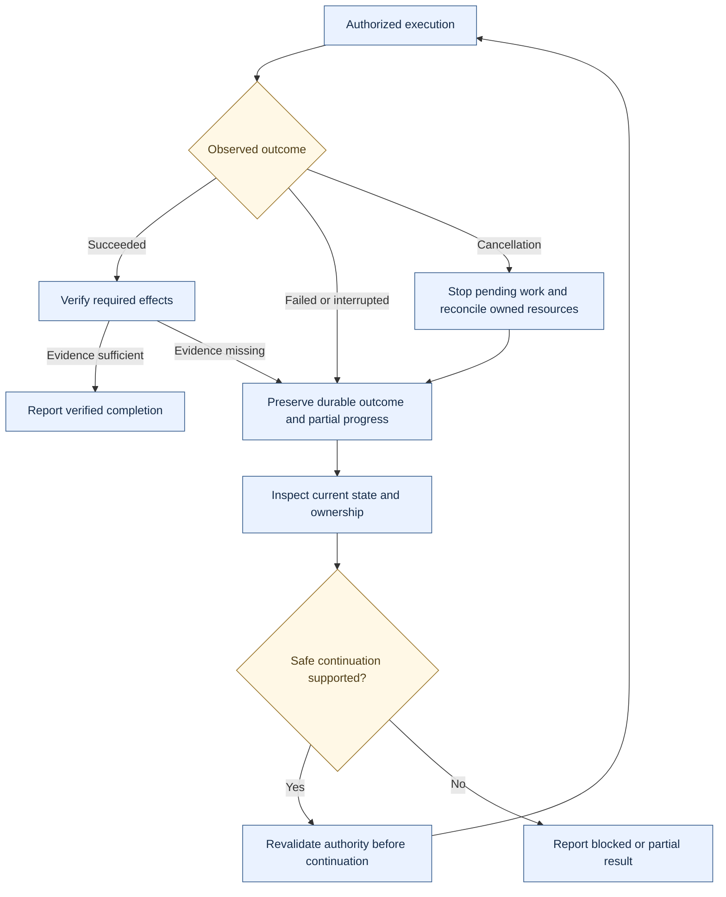

# Reliability and execution assurance

[Overview](README.md) · [Case studies](ENGINEERING.md) · [Limitations](LIMITATIONS.md)

## Design principles

Language interpretation proposes work. Execution authority comes from the current controller state and user authorization. Historical memory, capability discovery, and model confidence do not expand that authority. Completion claims must be grounded in observed results appropriate to the requested effect.

| Failure or threat category | Conceptual response | Evidence boundary |
| --- | --- | --- |
| Untrusted or mistaken model output | Validate proposals before effects | Action-controller and semantic-boundary tests; no universal prompt-injection immunity claim |
| Stale or ambiguous application target | Check current state and ownership; clarify when unresolved | Owned-resource and desktop-state tests; host observations remain imperfect |
| Repeated delivery or restart | Preserve durable outcome and reconcile current state | Replay/restart tests for selected effects; no universal exactly-once claim |
| Partial action failure | Record per-action outcome and respect dependencies | Dependency and cancellation tests; external applications do not share one transaction |
| Approval waiting or denial | Persist waiting state; require current authority before execution | Approval/controller tests; no published permission rules or internal contracts |
| Unsupported completion claim | Compare required effects with system evidence | Receipt and lifecycle verification tests; observed dispatch can be weaker than usable completion |
| Interrupted execution | Stop pending work, preserve partial state, inspect owned resources | Bounded recovery tests; remote saturation and physical voice interruption remain open |
| Stale contextual history | Scope retrieval and check freshness after changes | Memory correction/revision/isolation tests; broad real-world recall unmeasured |

## Failure and recovery flow

*This describes recovery responsibilities, not a retry algorithm. Continuation depends on supported operations, current authority, and observed state. Some results must remain partial or blocked.*

Cancellation is a request to stop work, not proof that an effect never happened. Shared resources can outlive the requesting task; cleanup must respect ownership. A saved workstation edit changes intended state, while a live resource change needs its own observed outcome.

## Verification strategy

The private tests include disposable filesystem and database fixtures, real controller execution, restart/replay cases, worker process boundaries, conflicting resource coordination, and opt-in native desktop probes. Test doubles make failure paths repeatable; native probes check whether application integrations actually expose the expected state. These forms of evidence complement each other and are labelled separately.

Diagnostics record lifecycle events and verification outcomes so failed paths can be examined. This showcase contains only reviewed summaries. Raw diagnostic logs, requests, ownership identities, and operational security details remain private.

The strongest broad suite evidence is [E1](PERFORMANCE.md#e1--regression-suite). Its historical scope and skips prevent a blanket production-readiness declaration. These are engineering controls backed by bounded tests, not a formal security audit or independent penetration test.
